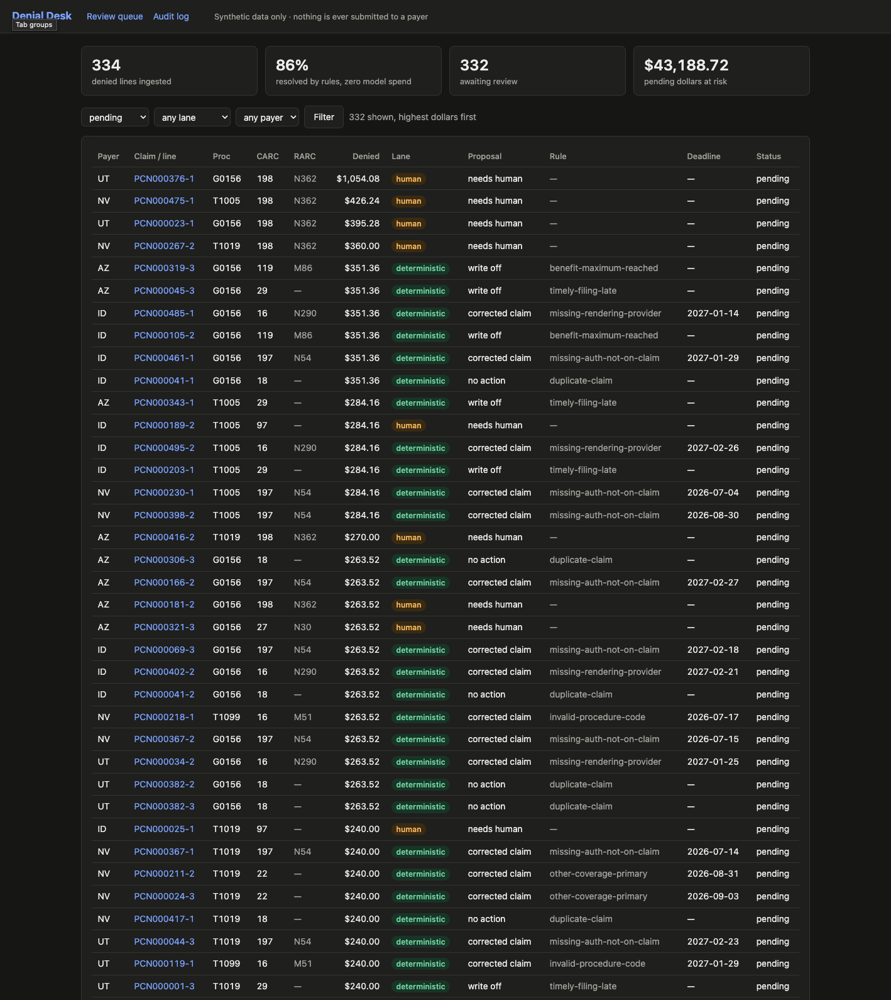
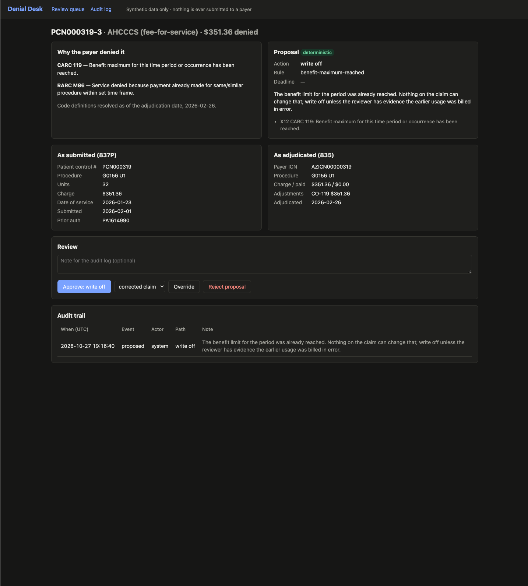
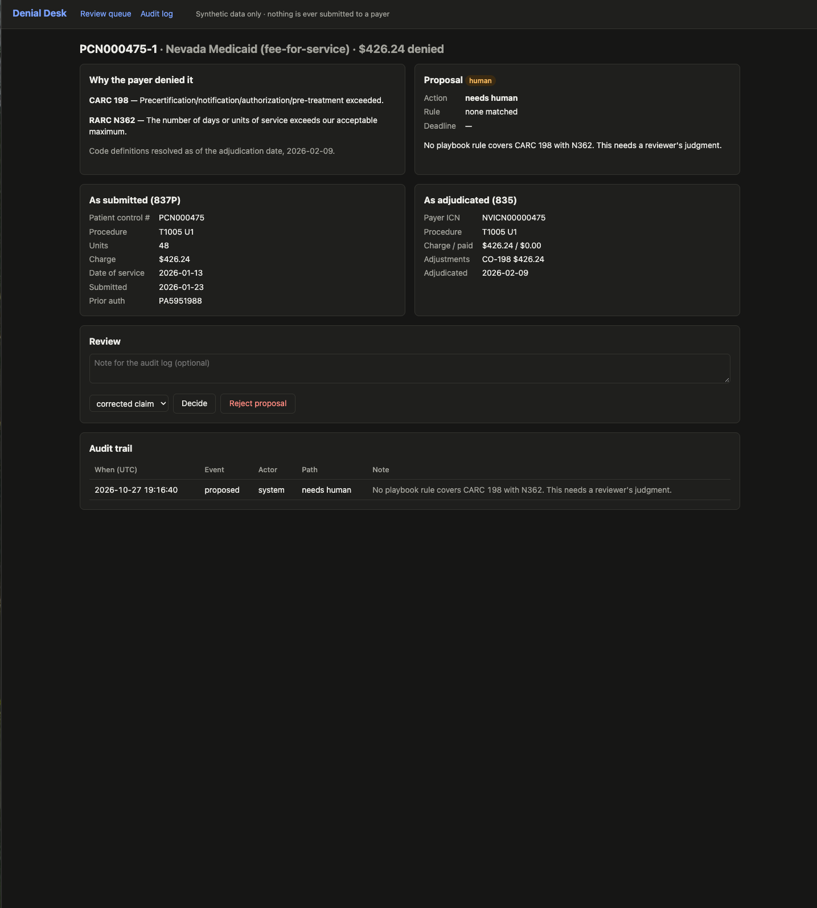

# Denial Desk

> **Status: rules lane, human review queue and audit log working; model lane evaluated, not
> yet wired into the queue.** **Synthetic data only. No PHI enters this system.**

Denial Desk reads Medicaid claim denials from X12 837P/835 files, works out what the payer
refused and why, and proposes the next action: corrected claim, appeal, write-off, or "a human
needs to decide." Every proposal goes to a review screen. Nothing is ever submitted to a
payer.

## Results so far

**Rules lane** — default synthetic run (`make demo`: seed 42, 500 claims, 334 denied lines):

| | |
|---|---|
| Denials proposed by rules, **zero model spend** | **86%** (288 of 334) |
| Rules-lane proposals matching the generator's ground truth | 100% (288 of 288) |
| Left for judgment | 14%: medical necessity, bundling, units over authorization, coverage ended, unexplained CARC 16 |

**Model lane** — the denials the rules leave behind (183 cases from 2,000 claims), each with
a case file of authorizations, eligibility, visit records and a care note.
[Full report](docs/EVAL_REPORT.md).

| | Sonnet 5.5 | Haiku 4.5 | CARC lookup baseline |
|---|---|---|---|
| Action accuracy | 44.3% | 50.8% | 47.0% |
| **Wrong actions asserted** | **0** | 31 | 44 |
| USD per claim | $0.0063 | $0.0026 | $0 |

**Accuracy ranks these models backwards.** Haiku scores higher by asserting more, and 31 of
its assertions are wrong — mostly appeals against denials the evidence supports. Sonnet
asserted no wrong action; its misses are handoffs to a reviewer, and one policy it was never
told (retroactive reinstatement should be suggested, not asserted). The worst slice for both
models is that policy: 0 of 33.

The first live run scored 33%, below the baseline. Reading the model's rationales found two
bugs in the eval, not the model — a missing input field, and synthetic visit records that no
longer matched billed units, which the model noticed and the tests had not.
[Run 1 write-up](evals/history/2026-11-05-run1-sonnet-v1-gen0.2.0/README.md).

**Read every number with care.** The denial mix, the case files and the prompt are written
by the same people, so the rules-lane share is a property of the declared mix and the model
numbers measure whether a model reads the evidence, not whether it copes with real data.
Treat them as upper bounds. Prompt-injection red-teaming is not built yet.

Every model number above reproduces with no API key: responses are recorded once and
replayed (`make eval-accuracy`).

## What it looks like

`make demo` generates the data, ingests it and serves the review queue at
http://localhost:8000. The queue is sorted by dollars at risk. Each denial shows the CARC
and RARC definitions as of the adjudication date, the line as billed next to the line as
adjudicated, the proposed action with its citations and computed filing deadline, and three
buttons: approve, override, or reject. Every decision is appended to an audit log that the
database refuses to update or delete.



| Rules lane: a cited, deterministic proposal | Human lane: no rule applies, a reviewer decides |
|---|---|
|  |  |

## Architecture

```
 837P files ─┐                         ┌─ playbook match ─▶ deterministic proposal ─┐
             ├─ parse ─▶ join on ──────┤                                            ├─▶ review queue ─▶ human decision
 835 files ──┘  (X12)   (PCN, REF*6R)  └─ no match ──────▶ needs_human ─────────────┘        │
                                                                                   append-only decision_audit
```

- **X12 parsing** (`ingest/x12/`) is hand-written and covers only the segments a denial
  needs. A CAS segment carries up to six reason/amount triplets. Each 835 line must balance
  (charge − paid = sum of adjustments), or parsing fails rather than producing wrong numbers.
- **The denial record** (`domain/`) keeps "as billed" (837) and "as adjudicated" (835) as
  separate types. A line counts as denied when it has an adjustment that is not patient
  responsibility and not CO-45 (fee-schedule reduction, which is on nearly every paid line).
- **The rules lane** (`triage/playbook.yaml`) has 13 entries keyed on CARC, plus RARC and a
  condition where one is needed. Each entry cites the code definition it relies on. Filing
  deadlines are computed in Python from public payer rules (`reference/payers.json`), and
  the screen flags payers whose limits are not yet verified.
- **Persistence** is SQLAlchemy over SQLite by default and Postgres via `DATABASE_URL`.
  Ingest is idempotent: an 835 is skipped by its TRN02 trace number, and each denial is
  unique on (patient control number, line control number).

Every decision, with what was rejected: [docs/DECISIONS.md](docs/DECISIONS.md). The full
internal guide: [docs/ARCHITECTURE.md](docs/ARCHITECTURE.md).

## Running it

Requires Python 3.12 and [uv](https://docs.astral.sh/uv/).

```bash
make install        # uv sync --all-extras
make demo           # generate 500 synthetic claims, ingest them, serve http://localhost:8000
make test           # 41 unit tests, no network, no database server
make eval-accuracy  # model-lane eval, replayed from committed recordings (no API key)
```

## Scope and honesty

- **Synthetic data.** The four payers (UT, AZ, NV, ID) are modeled on public fee-for-service
  rules. The claims, members and providers are fabricated, and the denial mix is declared
  rather than measured.
- **Narrow X12.** The parsers read only the loops this system needs. Real clearinghouse files
  contain more, which is skipped. Reversals (CLP02 = 22) are reported and skipped; pairing a
  reversal with its re-adjudication is not built.
- **Citations.** Rules cite X12 code definitions and, for deadlines, the payer's public
  filing rule. Nevada's correction window and Idaho's manual section are not yet confirmed
  and are flagged as unverified on screen.
- **No model lane yet.** Anything the rules don't cover goes to a person. A model-assisted
  lane, judged against hand-labeled data, is the next stage.
- **Deliberately not built:** authentication, multi-tenancy, a polished frontend, real payer
  integration, auto-submission of anything (ADR-007, ADR-025).

## License

MIT
